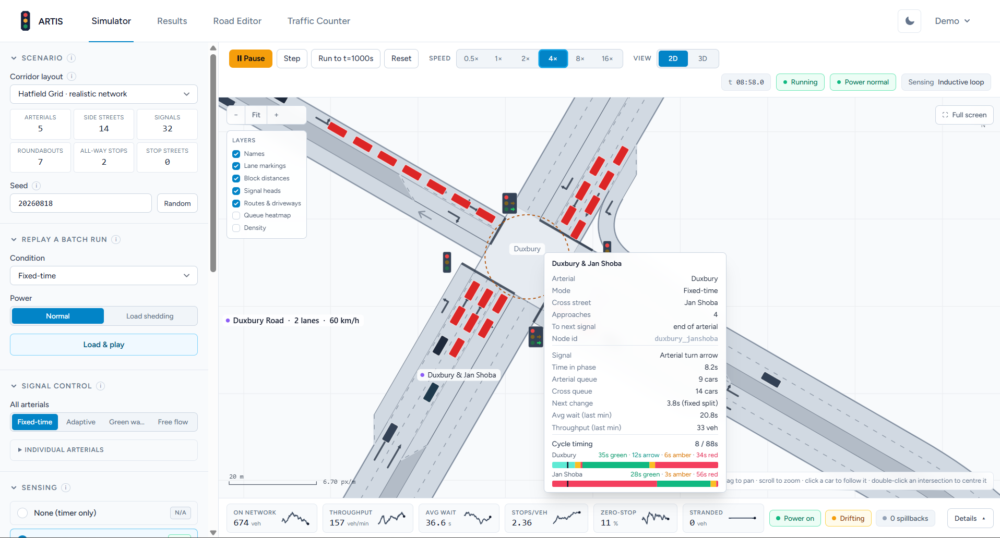
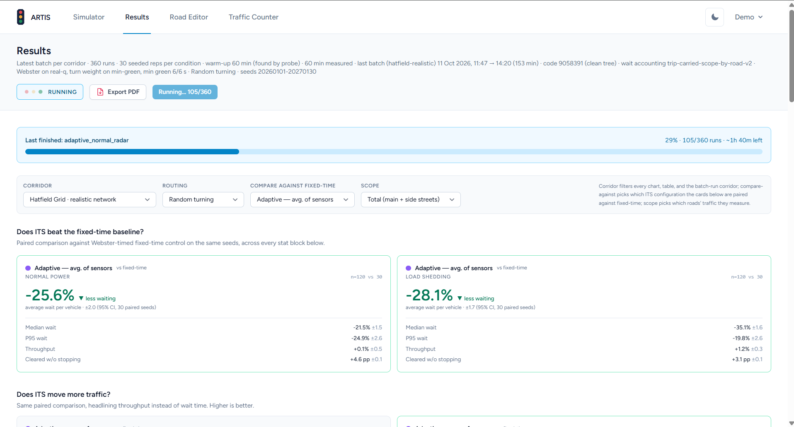
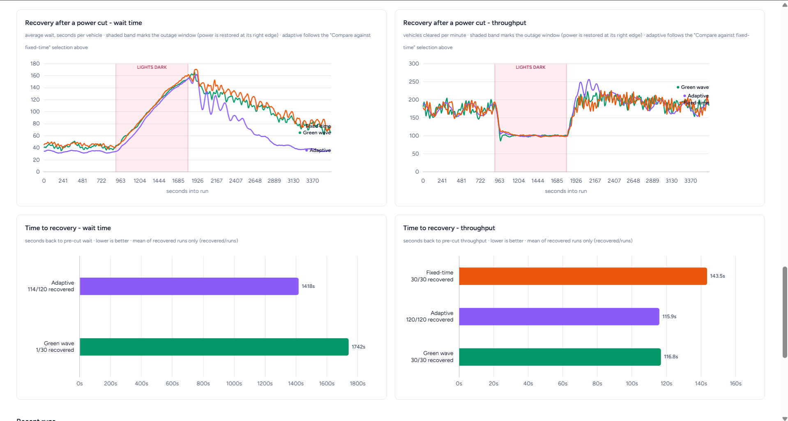
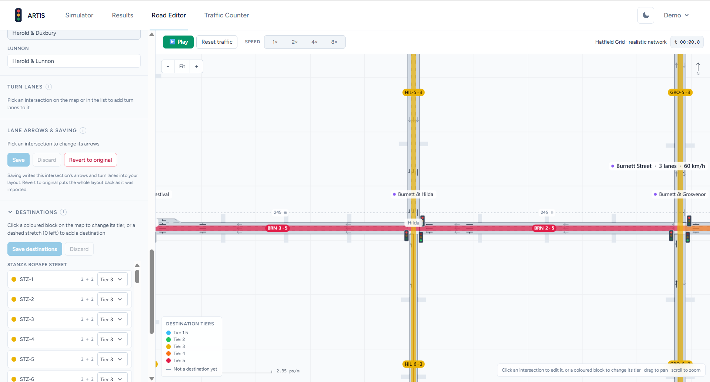
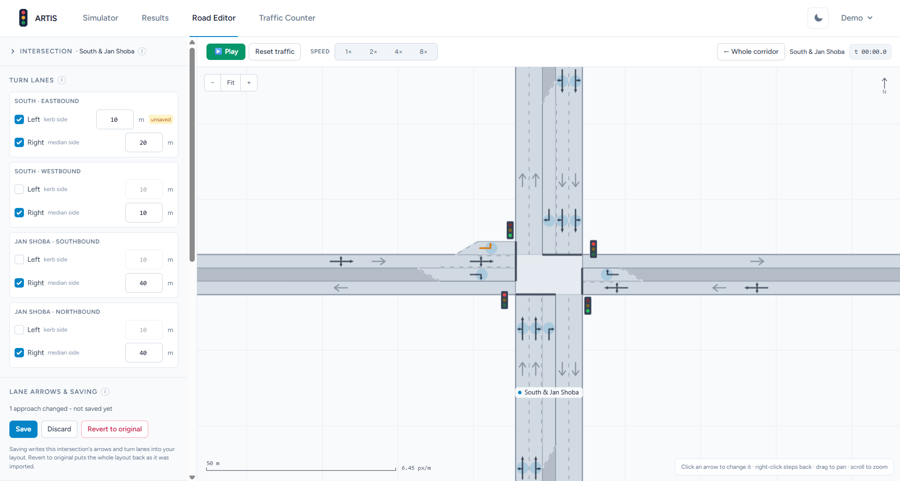
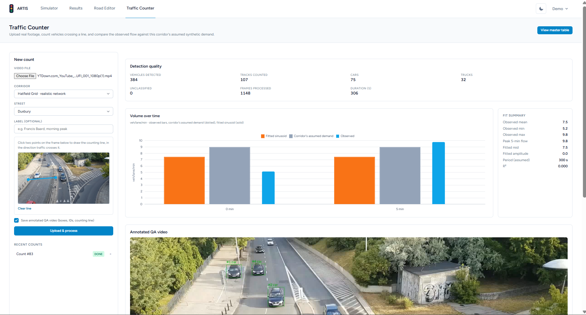

# ARTIS: Adaptive Road Traffic Intersection Simulator

ARTIS at its core is a browser-based traffic simulator that lets you compare three different ways of controlling traffic signals on the same road network, using the same seeded traffic every time, and then cuts the power mid-run to see which of those approaches actually holds up when the lights go dark. It's modelled on a South African context.

---

## Screenshots

**Simulator**, running the Hatfield Grid at 4x with a junction popup open: signal phase, cycle timing including the arterial turn-arrow stage, queue lengths on both roads, and the time to the next change.



**Results**, aggregated over 360 seeded batch runs (12 conditions x 30 seeds), each paired against the Webster fixed-time baseline. The header records the warm-up found by probe, the commit the batch ran on, and the timing rules used.



**Recovery after a power cut**, showing how fast each controller gets wait time and throughput back to where they were before the cut. Both are tracked because they recover on different timescales.



**Road Editor, destinations**, where each block of road gets a destination tier. In destination routing, cars draw a trip to a block and drive to it, instead of turning at random.



**Road Editor, turn lanes**, where a junction's turn pockets and lane arrows are edited per approach and saved into the user's own layout.



**Traffic Counter**, for comparing the simulator's assumed demand against real footage.



---

## What the app actually does

The `/simulator` page draws a corridor straight from a JSON file: surfaces, lane markings, stop lines, turn pockets, junction boxes, signal heads, roundabout islands and driveways, in 2D or 3D, pannable and zoomable. Cars follow the Intelligent Driver Model, change lane with MOBIL, and come in a car plus three truck sizes, each with a slider. Click a car and the camera follows it, with a card showing its route, trip time and delay.

**Junction control is set per junction** (`control` in the layout): `signal`, `roundabout`, `allWayStop` or `stop` (a minor-road stop street, supported by the engine but not used in the main layout). Roundabouts are 36 m across by default; every movement circulates the island and enters by gap acceptance. All-way stops release one approach at a time, first come first served, and hold the box until it is empty. A signalised junction can also carry a protected lead turn stage (`turnPhases`), shown with the South African two-column head. Right-turners on a green ball may pull into the junction (at most two per approach) and clear on the oncoming amber. Left-turn slip lanes and long turn pockets are modelled as real roads and lane slots.

**Signal control** is one of four controllers in `resources/js/sim/controllers/`:

- `fixedTime.js`: Webster's method. The formula is untouched; only its inputs are corrected: s = 1250 veh/h/lane (measured on the engine's own cars), the busiest lane of each approach, and a 1.25 factor on turning cars.
- `adaptive.js`: sensor-driven gap-out, at four sensor fidelity levels. Radar and camera also switch a waiting call after 10 s, and radar averages its count over 3 s.
- `greenWave.js`: a common cycle along each arterial with offsets measured along the road, allowing for starting from rest. A junction whose own cycle fits half the common cycle runs that half twice.
- `allWayStop.js`: what every signal becomes during load shedding. `roundabout.js` and `minorStop.js` handle the other junction controls.

Sensor fidelity (`sensors.js`) runs from inductive loop and magnetometer through radar to camera.
**Routing.** From 12 Oct 2026 batches and reports use **destination routing**. Each origin draws a trip to a block and direction, weighted by the block's tier (1.5, 2, 3, 4 or 5, edited in the Road Editor). Routes come from a graph built out of the engine's own gates, lane use and joins, so a route only uses movements the engine can drive. The car then pulls into one of that block's driveways, with a gap wait where it crosses oncoming traffic, or falls back to a later driveway if it misses. Random turning is still in the engine and its pinned seeds are still tested, but it is no longer batched.

**Warm-up is measured, not assumed.** Before every batch a probe runs each controller for two hours from empty. A settling detector (MSER cut plus a drift check, `plateau.js`) finds when each scope levels off, and the batch warms up for the slowest controller times 1.5, between 6 and 90 minutes. A controller that never settles flags the batch as not stationary. The measured window is 90 minutes with a 15-minute power cut starting at minute 15, so 60 minutes remain after power returns.

**Everything is seeded** (`rng.js`), so a run is reproducible to the byte whether played in the browser or headless. The batch runner (`batch/runBatch.mjs`, or the "Generate dataset" button on Results, which uses a worker pool) runs 12 conditions x 30 seeds and posts to `/api/simulation-runs` and `/api/recovery-ticks`. Every run stores the commit, tree state, wait accounting, signal rules, routing mode, tier hash and seeds.

**Live statistics** (`resources/js/sim/metrics/`) use one definition per metric, shared by the live panel, the batch summary, the settling detector and the report. A stopped car is under 0.3 m/s and a stranded one has stood for 300 s. A read-only **lockup watch** flags a whole waits-on chain standing for 300 s as a lockup (which fails the batch) and a standstill behind a queue that still moved as starvation.

**Results** (`/results`) show each corridor's latest batch only, split Total / Arterial / Side Streets, with:

- paired comparisons against fixed-time on the same seeds, with Student's-t 95% intervals on the paired differences, and median and P95 beside the mean;
- a delta coloured only when it clears its interval, otherwise "no clear difference";
- recovery after the power cut on both a throughput basis and a wait basis;
- a destination routing table (trips, trip delay, missed turns and driveways, diversion);
- a lockup or not-stationary banner when a batch has one;
- a PDF export that carries the same numbers and the batch stamp.

Wait is counted trip-carried: the total counts each vehicle once with its whole trip, and the arterial and side-street scopes count each vehicle that used them with the wait built up there, so the scopes do not add to the total.

**Also in the Simulator:** a replay of any representative batch run, a per-user layout list, a random-events mode (a fun-only toggle, off in batches and replays), a "Routes & driveways" layer, queue heatmap and density layers, and a collapsible control rail.

`tests/Feature/NavigationTest.php` guards navigation, layout and every control against regressions. `npm run test:sim` runs the pinned-seed trajectory hashes, the summary baselines, the live-versus-report identity tests and the lockup tests; any intended dynamics change has to recapture them (`node tests/js/fixtures/captureBaselines.mjs`).

---

## The traffic counter

The `/traffic-counter` tab compares the simulator's assumed demand against real footage. Upload a video, draw a line across the road, and the app counts vehicles crossing it (car, truck, unclassified), then fits a sinusoid to the observed flow with its R². The sidebar lists recent counts; "View master table" shows every count, paginated, with delete.

Video processing is a queued job (`ProcessTrafficCount`), so a worker has to be running:

```
php artisan queue:work
```

`QUEUE_CONNECTION=database` is already set, and `scripts/queue-worker.ps1` can be registered as a Windows scheduled task to keep it alive. Detection runs in `scripts/traffic_counter/count_vehicles.py` (YOLOv8 and ByteTrack), which needs Python and ffmpeg on PATH:

```
pip install -r scripts/traffic_counter/requirements.txt
```

Set `PYTHON_BIN` in `.env` if `python` on PATH isn't the right interpreter.

---

## Running it locally

Served by Laravel Herd at **http://traffic-simulator.test**.

The project folder is `Traffic-Simulator`. A directory junction maps it to the `traffic-simulator` hostname without needing admin rights:

```
mklink /J "%USERPROFILE%\.config\herd\config\valet\Sites\traffic-simulator" "%USERPROFILE%\Herd\Traffic-Simulator"
```

(`herd link traffic-simulator` does the same thing but needs elevation, because it creates a symlink rather than a junction.)

Setup from scratch:

```
composer install
npm install
cp .env.example .env && php artisan key:generate
php artisan migrate --seed
npm run build      # or: npm run dev
```

Sign in with `demo@traffic-simulator.test` / `password` (seeded by `DatabaseSeeder`), or register a new account.

### Database

Runs on **MySQL** (`traffic_simulator` on `127.0.0.1:3306`). `.env` is configured with:

```
DB_CONNECTION=mysql
DB_HOST=127.0.0.1
DB_PORT=3306
DB_DATABASE=traffic_simulator
DB_USERNAME=root
DB_PASSWORD=...
```

SQLite (`database/database.sqlite`) still works as a fallback, just set `DB_CONNECTION=sqlite`.

### Batches from the command line

```
node batch/runBatch.mjs --corridor=hatfield-realistic --routing=destination
node batch/runBatch.mjs --corridor=hatfield-realistic --routing=destination --probe-only
```

`--warmup-ticks=auto` is the default. The CLI runs one at a time; the Results button runs a worker pool.

### Tests

```
php artisan test
npm run test:sim
```

`NavigationTest` covers the navigation path. The other feature tests cover corridor layouts, lane use, routing tiers, the Road Editor page, run storage, the per-seed confidence interval on the sensor average, the lockup banner and the Traffic Counter list and delete paths.

---

## Layout is data, not code

Nothing about the road network is hardcoded. `corridors/*.json` are **read-only templates**, shared by the browser, the headless batch runner, Results and the Traffic Counter. Each account gets its own editable copy in the `corridor_layouts` table; the Road Editor writes lane arrows, turn pockets and destination tiers there, and "Revert to original" restores the layout as imported. Because batches run on the template, the Results "Generate dataset" dialog and the Road Editor warn when a user's layout has drifted from it.

| File | Purpose |
|---|---|
| `hatfield-realistic.json` | The main scenario: the full Hatfield Grid |
| `hatfield-turn-lanes.json` | The earlier 2-arterial layout with realistic turn lanes |
| `hatfield-pretorius-francisbaard.json` | The original placeholder corridor: 2 arterials x 4 intersections |
| `two-intersection-test.json` | Smallest config that still exercises the loader |
| `single-intersection.json` | One 4-way junction, easiest to debug controllers on |

**Geometry conventions** (see `resources/js/sim/corridor.js`):

- metres; x increases east, y increases **south**, matching canvas axes
- an arterial has an `origin` and a `direction` (or `headingDeg`); junction positions come from walking the `distanceToNextM` chain, so the distances that drive green-wave offsets are the same numbers that place the drawing
- **left-hand traffic** (South Africa): the lanes carrying a heading, and its signal head, are on the left of the centreline
- connectors (cross streets) carry a `scope` of `"arterial"` or `"side"`, which decides which metric bucket their traffic is counted in; only the five main roads are arterials
- `joins` hand one road over to the next (plain, merge or peel-off, or a slip), so lanes, queues and sensors carry across
- per-junction fields: `control`, `turnPhases`, `slipLanes`, `laneUse` and `turnLanes` (pockets, 10 m by default)
- a `routing` block holds the destination blocks and their tiers

---

## Where things live

```
routes/web.php                              # pages, /corridors/*, /results/data, /api/*
app/Http/Controllers/
  SimulatorController.php                   # simulator page, corridor JSON, sample runs for replay
  RoadEditorController.php                  # Road Editor page
  CorridorLayoutController.php              # create/delete a user's layout
  CorridorTemplateController.php            # read-only template, for "Revert to original"
  CorridorLaneUseController.php             # saves lane arrows and turn pockets
  CorridorRoutingTierController.php         # PUT /corridors/{id}/routing-tiers
  ResultsController.php                     # latest batch, scoped metrics, paired CIs
  SimulationRunController.php               # POST /api/simulation-runs
  RecoveryTickController.php                # POST /api/recovery-ticks
  TrafficCounterController.php              # upload, status, data, video, list, delete
app/Support/                                # CorridorRepository, UserCorridorLayouts, lane-use and tier editors,
                                            #   ConfidenceInterval, SeedPairedDeltas, RoutingMetrics
app/Models/                                 # SimulationRun, SimulationRunRecoveryTick, CorridorLayout,
                                            #   TrafficCount, TrafficCountBucket
corridors/*.json                            # read-only layout templates
resources/views/                            # simulator, results (+ partials), road-editor, traffic-counter
resources/js/
  simulator.js                              # Simulator page wiring
  roadEditor.js  laneEditor.js              # Road Editor: map, lane arrows, turn pockets
  destinationsEditor.js                     # destination tiers
  results.js  resultsPdf.js                 # dashboard, batch dialog, PDF export
  traffic-counter.js  railAccordion.js  theme.js  tooltips.js
  renderers/                                # 2D and 3D renderers, turn-lane and car shapes
  charts/theme.js                           # shared Chart.js theme
  sim/
    corridor.js  intersectionLayout.js      # config -> geometry graph
    equations.js                            # IDM, Webster, green-wave offset, MOBIL, Poisson arrivals
    car.js  engine.js  rng.js               # vehicles, tick loop, seeded PRNG
    controllers/                            # fixedTime, adaptive, greenWave, allWayStop, minorStop,
                                            #   roundabout, phasePlan
    sensors.js                              # sensor fidelity modes
    routing/                                # graph, blocks, driveways, OD table, candidates, config
    metrics/                                # definitions, live collector, live stats panel
    plateau.js  warmupProbe.js              # settling detector and pre-batch probe
    lockupWatch.js  layoutDrift.js
    runHeadless.js  experimentalMatrix.js   # headless driver and the 12-condition matrix
    batchSchedule.js  batchWorker.js        # one source for the schedule; worker pool
    apiPayload.js  recoveryTickPayload.js
batch/                                      # runBatch, fingerprint, trajectoryHash, warmupDiagnostics, verify
scripts/
  slip-lanes.mjs  add-herold.mjs  fix-dyer-herold.mjs   # layout generators
  routing-validate.mjs  routing-validation.mjs          # destination routing checks
  preview/                                  # headless probes (queue, ring, let-in, drift, flow, ...)
  traffic_counter/count_vehicles.py         # YOLOv8 vehicle detection
  queue-worker.ps1                          # keeps queue:work alive
tests/Feature/  tests/js/                   # PHP feature tests; pinned-seed simulation tests and baselines
results/                                    # batch CSV/JSON output
```

## Models behind the simulation

Each behaviour model has a citation rather than being an ad hoc rule someone made up:

- **Car following**: Intelligent Driver Model (Treiber, Hennecke & Helbing, 2000)
- **Lane changing**: MOBIL (Kesting, Treiber & Helbing, 2007), with politeness and threshold tuned per vehicle type so trucks change lanes less readily than cars
- **Fixed-time timing**: Webster's method (Webster, 1958) for cycle length and phase splits, so the baseline is a legitimate implementation rather than a strawman. Webster's formula is never altered; only the flows it is given are corrected (busiest lane, turning cars at 1.25, s = 1250)
- **Adaptive control**: a threshold/gap-extension heuristic mirroring the sense, decide, execute ATSC loop of SCATS/SCOOT
- **Green wave**: standard progression-band coordination, offset equals distance divided by target speed, per arterial and one directional, on the critical junction's cycle
- **Warm-up**: MSER truncation (White, 1997) with a drift check on what remains
